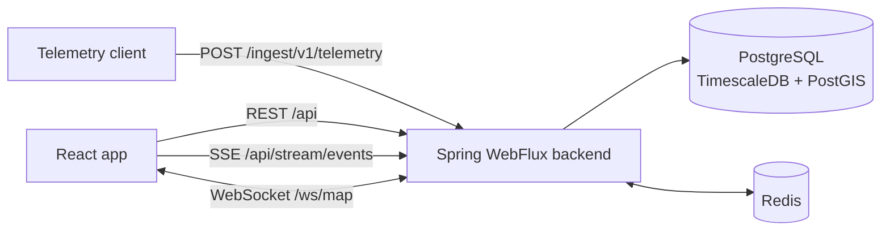

# Fleet Mission Control

A real-time, multi-tenant operations dashboard for a fleet of vehicles. Operators watch units move on a live map, follow fleet metrics as they stream in, and react to alerts, all inside a tenant-isolated workspace.

The project is built to show backend depth (a fully reactive pipeline, database-enforced tenant isolation, viewport-filtered streaming) and frontend polish (a GPU-rendered map, streaming charts, a draggable dashboard grid).

> **Status:** working end to end. Map integrity adjustments are still in progress (see [Known limitations](#known-limitations)).

## Features

- **Live map** with vehicles streamed over a WebSocket, filtered to what the current viewport needs, and clustered when zoomed out.
- **Streaming fleet metrics and alerts** pushed over Server-Sent Events, with resume after reconnect.
- **Customizable dashboards**: draggable, resizable widgets (map, live chart, status tiles, alert list), private or shared with the tenant.
- **Multi-tenancy**: demo tenants whose data never mixes, enforced by PostgreSQL row-level security rather than application code alone.
- **Role-based access**: viewers read, operators also edit dashboards, act on alerts, and trigger the demo outage scenario.
- **Machine ingestion**: a per-tenant API-key endpoint that accepts batched telemetry.

## Architecture



Three channels carry data to the browser: REST for ordinary requests, a WebSocket for the map (the client sends its viewport, the server answers with snapshots and deltas), and SSE for alerts and chart updates.

### Key design decisions

- **Reactive end to end.** Spring WebFlux with R2DBC and reactive Redis; ingestion buffers events and writes them to the database in batches.
- **Tenant isolation in the database.** Row-level security on every tenant-owned table, with the tenant set per transaction. Pre-login lookups go through narrow security-definer functions.
- **Viewport filtering by tiles.** Vehicles are indexed by map tile, so each connection receives only updates for the tiles it can see.
- **Snapshot then deltas, with sequence numbers.** Each vehicle update carries a per-vehicle sequence number, so the client keeps only the newest and stale messages are ignored.
- **Conflation for slow clients.** Each connection keeps only the latest update per vehicle instead of queueing every one.
- **Time-series storage.** Telemetry lives in a TimescaleDB hypertable with continuous aggregates for charts. Compression is left off because TimescaleDB does not support row-level security on compressed chunks.

## Tech stack

| Area | Technology |
| --- | --- |
| Backend | Java, Spring Boot (WebFlux), R2DBC, Spring Security with JWT, Flyway, Micrometer |
| Data | PostgreSQL with TimescaleDB and PostGIS, Redis |
| Frontend | React, TypeScript, Vite, Tailwind CSS, shadcn/ui, TanStack Query, Zustand, React Router |
| Map and charts | MapLibre GL JS, uPlot, react-grid-layout |
| Testing | JUnit with Testcontainers (backend) |

## Repository layout

```text
.
├── BackEnd/                                Spring Boot (WebFlux) application, layered controller > service > repository
│   ├── pom.xml                             Maven build and dependencies
│   └── src/
│       ├── main/
│       │   ├── java/com/fleetcontrol/backend/
│       │   │   ├── BackendApplication.java
│       │   │   ├── config/                 Wiring
│       │   │   │   ├── AppProperties.java            Typed app.* settings (JWT, CORS, ingestion and map tuning)
│       │   │   │   ├── SecurityConfiguration.java    Separate security chains for user routes and ingestion
│       │   │   │   ├── JwtConfiguration.java         Token signing and validation
│       │   │   │   ├── PasswordConfiguration.java    Password hashing
│       │   │   │   ├── RedisConfiguration.java       Reactive Redis templates and listeners
│       │   │   │   └── MapWebSocketConfiguration.java  Registers the /ws/map endpoint
│       │   │   ├── controller/             Entry points for HTTP, SSE, and WebSocket
│       │   │   │   ├── AuthController.java           Login and current user
│       │   │   │   ├── DomainController.java         Vehicles, districts, alerts, dashboards, metrics
│       │   │   │   ├── EventStreamController.java    SSE stream of alerts and fleet metrics
│       │   │   │   ├── MapWebSocketHandler.java      Map socket: auth, viewport, snapshots, deltas
│       │   │   │   ├── TelemetryIngestionController.java  Batched telemetry, API-key protected
│       │   │   │   ├── ScenarioController.java       Trigger the demo outage
│       │   │   │   └── ScenarioCommandController.java  Commands polled by telemetry clients
│       │   │   ├── service/                Business rules and reactive pipelines
│       │   │   │   ├── LoginService.java             Credential check and token issue
│       │   │   │   ├── DomainService.java            Fleet data, alerts, and dashboard rules
│       │   │   │   ├── DomainSupport.java            Helpers shared by the domain service
│       │   │   │   ├── TelemetryIngestionService.java    Validation, sequencing, live-state updates
│       │   │   │   ├── TelemetryPersistencePipeline.java Batched writes to TimescaleDB
│       │   │   │   ├── VehicleOwnershipCache.java    Per-tenant vehicle IDs used to validate telemetry
│       │   │   │   ├── MapTileRegistry.java          Which connections subscribe to which tiles
│       │   │   │   ├── MapUpdateDispatcher.java      Delivers live updates to subscribed connections
│       │   │   │   ├── EventStreamService.java       Builds the SSE event flow
│       │   │   │   ├── ScenarioService.java          Outage scenario logic
│       │   │   │   └── TenantTransaction.java        Runs work in a transaction that sets the tenant first
│       │   │   ├── repository/             Data access
│       │   │   │   ├── DomainRepository.java         Fleet data, alerts, dashboards (PostgreSQL)
│       │   │   │   ├── IdentityRepository.java       Users, API keys, and the pre-login lookups
│       │   │   │   ├── TelemetryRepository.java      Telemetry writes and aggregate queries
│       │   │   │   ├── TelemetryLiveRepository.java  Redis latest state, geo index, tile counts
│       │   │   │   └── ScenarioRepository.java       Scenario commands
│       │   │   ├── security/               Authentication and tenant context
│       │   │   │   ├── TenantContextWebFilter.java   Puts tenant and role into the reactive context
│       │   │   │   ├── TenantIdentity.java, FleetAuthentication.java  Authenticated principal
│       │   │   │   ├── ApiKeyAuthenticationManager.java, ApiKeyAuthenticationToken.java, ApiKeyCredential.java  Ingestion auth
│       │   │   │   ├── WebSocketJwtAuthenticator.java    Validates the socket's first auth message
│       │   │   │   ├── LoginRateLimiter.java         Throttles login attempts
│       │   │   │   └── ProblemResponseWriter.java    Uniform 401 and 403 responses
│       │   │   ├── dto/                    What goes in and out
│       │   │   │   ├── request/                      Login, telemetry batch, dashboard, district, outage requests
│       │   │   │   ├── response/                     Typed responses plus the page envelope
│       │   │   │   └── message/MapSocketMessage.java WebSocket message types
│       │   │   ├── mapper/DomainMapper.java          Model to response conversion
│       │   │   ├── model/                  Enums (alert kind, severity, status; vehicle kind, status; user role; widget type) and telemetry records
│       │   │   ├── exception/              ApiException and the global error handler
│       │   │   └── util/SlippyMapTiles.java          Latitude/longitude to map-tile math
│       │   └── resources/
│       │       ├── application.yml, application-dev.yml, application-prod.yml  Base and per-profile settings
│       │       └── db/migration/           Flyway migrations, applied in order
│       │           ├── V1  Verify database prerequisites (extensions, roles)
│       │           ├── V2  Identity tables and pre-login lookup functions
│       │           ├── V3  Districts and vehicles
│       │           ├── V4  Telemetry hypertable
│       │           ├── V5  Continuous aggregates and tenant-scoped views
│       │           ├── V6  Alerts
│       │           ├── V7  Dashboards and widgets
│       │           ├── V8  Demo tenants
│       │           ├── V9  Verify row-level security coverage
│       │           ├── V10 Alert change timestamps
│       │           └── V11 Scenario commands and district alert deduplication
│       └── test/java/com/fleetcontrol/backend/   Application test and Testcontainers configuration
│
├── DataBase/                               SQL run outside the application
│   ├── bootstrap.sql                       One-time setup, run as a superuser before the backend starts
│   ├── V1__initial_schema.sql              Initial schema script
│   ├── demo_seed.sql                       Demo data
│   └── refresh_demo_aggregates.sql         Refreshes the continuous aggregates after seeding
│
└── FrontEnd/                               React + TypeScript single-page app (Vite)
    ├── index.html
    ├── package.json                        Scripts and dependencies
    ├── vite.config.ts                      Build and dev-server configuration
    ├── components.json                     shadcn/ui configuration
    ├── .env                                Backend and map-style addresses
    ├── public/                             Static icons
    └── src/
        ├── main.tsx, App.tsx, index.css    Entry point and global styles
        ├── app/                            Application shell
        │   ├── AppShell.tsx                Sidebar, top bar, connection indicator
        │   ├── router.tsx                  Route table
        │   ├── RouteGuards.tsx             Sign-in and role checks for routes
        │   ├── providers.tsx               Query client, toasts, realtime session
        │   └── queryClient.ts              TanStack Query defaults
        ├── features/                       One folder per feature (api, components, hooks, store)
        │   ├── auth/                       Login page, auth store, login and current-user calls
        │   ├── dashboards/                 Dashboard list and detail pages, widgets, map widget, dashboard queries and mutations
        │   ├── fleet/                      Vehicle list and detail, districts page, fleet queries
        │   ├── alerts/                     Alert queries and actions
        │   ├── metrics/                    Streaming fleet chart (uPlot)
        │   ├── map/                        Live map route, WebSocket client, map store, basemap helpers
        │   └── realtime/                   SSE client, connection-status store, map socket context, session that owns both connections
        ├── shared/
        │   ├── api/                        HTTP client (token, error mapping) and query keys
        │   ├── types/contracts.ts          zod schemas mirroring the backend responses and messages
        │   └── ui/                         Loading, empty and error states, toast helpers
        ├── components/ui/                  shadcn/ui components
        └── lib/utils.ts                    Small shared helpers
```

The backend follows an MVC-style layering: controllers handle HTTP, SSE, and WebSocket entry points; services hold business rules and reactive pipelines; repositories do data access; DTOs and mappers shape what clients receive.

## Prerequisites

- Java 21 or newer (the Maven wrapper is included)
- Node.js 20.19+ or 22.12+ (required by Vite 8)
- PostgreSQL, the latest release, with the PostGIS and TimescaleDB extensions installed
- Redis, installed locally or run in Docker (see [step 2](#2-start-redis))
- `psql`, to run the database scripts

## Quick start

### 1. Install PostgreSQL with PostGIS and TimescaleDB

1. Install the latest PostgreSQL release for your operating system. Before choosing a version, check that both PostGIS and TimescaleDB publish packages for that major version.
2. Install **PostGIS** and **TimescaleDB** for the same PostgreSQL major version, following each project's installation guide for your operating system. Installing PostgreSQL alone is not enough; the extensions are separate packages.
3. Enable TimescaleDB by adding it to the preloaded libraries in `postgresql.conf`, then restart PostgreSQL:

   ```text
   shared_preload_libraries = 'timescaledb'
   ```

4. Confirm both extensions are available. This query must return two rows:

   ```sql
   SELECT name, default_version FROM pg_available_extensions WHERE name IN ('postgis', 'timescaledb');
   ```

### 2. Start Redis

Install Redis locally if you can. Redis has no official native Windows build, so on Windows the easiest route is Docker, which is optional and used here only for Redis:

```bash
docker run -d --name fleet-redis -p 6379:6379 redis
```

### 3. Prepare the database

Run the bootstrap script as a superuser. It must run before the backend starts, because the first migration only verifies that its prerequisites exist.

```bash
psql -h localhost -U postgres -f DataBase/bootstrap.sql
```

Flyway then applies the migrations in `BackEnd/src/main/resources/db/migration` when the backend starts. For demo data and aggregate refresh scripts, follow `DataBase/README.md`.

### 4. Run the backend

```bash
cd BackEnd
./mvnw spring-boot:run -Dspring-boot.run.profiles=dev
```

On Windows, use `mvnw.cmd`. Connection settings live in `application.yml` and `application-dev.yml`; see [Configuration](#configuration).

### 5. Run the frontend

```bash
cd FrontEnd
npm install
npm run dev
```

Open the address Vite prints (by default `http://localhost:5173`) and sign in with one of the seeded demo accounts.

## Configuration

### Backend

Settings are bound from `application.yml` and overridden per profile (`dev`, `prod`). Secrets and connection details are meant to come from environment variables.

| Setting | Environment variable | Purpose |
| --- | --- | --- |
| `spring.r2dbc.*` | `SPRING_R2DBC_URL`, `SPRING_R2DBC_USERNAME`, `SPRING_R2DBC_PASSWORD` | Runtime database pool, as the non-owner runtime role |
| `spring.flyway.*` | `SPRING_FLYWAY_URL`, `SPRING_FLYWAY_USER`, `SPRING_FLYWAY_PASSWORD` | Migrations, as the owner role |
| `spring.data.redis.*` | `SPRING_DATA_REDIS_HOST`, `SPRING_DATA_REDIS_PORT` | Redis connection |
| `server.port` | `SERVER_PORT` | HTTP port |
| `app.*` | `APP_...` | JWT secret and lifetime, allowed origins, ingestion and map tuning (see `AppProperties.java`) |

The runtime and migration credentials must differ: the runtime role is not the table owner and cannot bypass row-level security, which is what makes tenant isolation meaningful.

### Frontend

Vite exposes only variables prefixed with `VITE_`. Values live in `FrontEnd/.env`.

| Variable | Purpose |
| --- | --- |
| `VITE_API_BASE_URL` | Backend REST and SSE base address |
| `VITE_WS_URL` | Map WebSocket address |
| `VITE_MAP_STYLE_URL` | Basemap style from a vector-tile provider |

Check `FrontEnd/.env` for the exact names and values this project uses.

## API overview

| Channel | Route | Purpose |
| --- | --- | --- |
| REST | `/api/auth/login`, `/api/me` | Authentication and current user |
| REST | `/api/vehicles`, `/api/districts`, `/api/alerts`, `/api/dashboards` | Fleet data, alerts, and dashboards |
| REST | `/api/scenarios/outage` | Trigger the demo outage (operator) |
| SSE | `/api/stream/events` | Alerts and fleet metrics |
| WebSocket | `/ws/map` | Viewport-filtered vehicle stream |
| Ingestion | `/ingest/v1/telemetry` | Telemetry batches, authenticated with an API key |
| Ingestion | `/ingest/v1/commands` | Scenario commands for telemetry clients |

See `Backend API Endpoints.md` for request and response details.

## Roles and demo accounts

| Role | Can do |
| --- | --- |
| Viewer | View dashboards, map, vehicles, districts, and alerts |
| Operator | Everything a viewer can, plus create and edit dashboards, acknowledge and resolve alerts, and trigger the outage scenario |

The demo tenants and their accounts are created by the migrations and seed scripts. Their credentials are listed in `DataBase/README.md`.

## Testing

```bash
# Backend (the integration tests use Testcontainers, so a container runtime must be available)
cd BackEnd
./mvnw test

# Frontend
cd FrontEnd
npm run lint
npm run build
```

## Documentation

| Document | Contents |
| --- | --- |
| `Design Report.md` | Goals, agreed decisions, architecture, and build plan |
| `Data Model.md` | Tables, constraints, row-level security, and Redis layout |
| `Backend Sheet.md`, `Backend Implementation Plan.md` | Backend setup, layering, pipelines, and build order |
| `Backend API Endpoints.md` | Endpoint and message reference |
| `Frontend Sheet.md`, `Frontend Implementation Plan.md` | Frontend setup, structure, realtime clients, and build order |

## Known limitations

- **Map integrity.** Adjustments to how the map reconciles vehicle updates are still in progress.
- **Telemetry source.** Live data comes from clients posting to the ingestion endpoint; no simulator is included in this repository.
- **Frontend tests.** The test folder is scaffolded but does not contain tests yet.

## Troubleshooting

| Symptom | Likely cause and fix |
| --- | --- |
| `extension "postgis" is not available` (or the same for `timescaledb`) | The extension package is not installed for the PostgreSQL version you are running. Install it for that exact major version, restart PostgreSQL, and re-run the `pg_available_extensions` query from step 1. |
| `timescaledb` is available but fails to load | `shared_preload_libraries` does not include `timescaledb`, or PostgreSQL was not restarted after changing it. |
| Backend fails at startup with a migration error | `DataBase/bootstrap.sql` has not been run, or was run against a different database than the one the backend connects to. |
| "Dashboards could not be loaded" or other query errors | The response shape did not match what the frontend expects, or the API base URL is wrong. Check the failing request in the browser's Network tab. |
| Map shows no vehicles | No telemetry has been ingested for the tenant, or the WebSocket did not connect; check the connection indicator and the browser console. |
